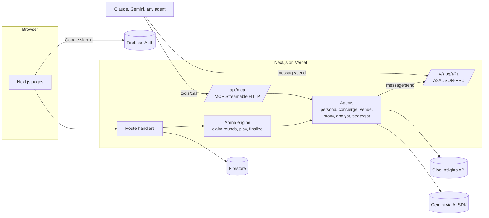

# Spotlit

**Get spotlit by agents.** AI assistants are starting to choose where people eat, drink and go out. Spotlit shows an independent venue how often agents choose it, why they pick a rival instead, and fixes it with real taste data from Qloo.

Built for the Qloo Agentic Hackathon 2026. MIT licensed. **Live app: [getspotlit.vercel.app](https://getspotlit.vercel.app)**


## Try it in 60 seconds

| What | Where |
| --- | --- |
| Demo venue, no login | [getspotlit.vercel.app/demo](https://getspotlit.vercel.app/demo) |
| Watch the arena replay | [getspotlit.vercel.app/demo/arena](https://getspotlit.vercel.app/demo/arena) |
| Before and after (measured lift) | [getspotlit.vercel.app/demo/compare](https://getspotlit.vercel.app/demo/compare) |
| Consumer concierge | [getspotlit.vercel.app/concierge](https://getspotlit.vercel.app/concierge) |
| A venue's A2A agent card | [getspotlit.vercel.app/v/halftone-house/.well-known/agent-card.json](https://getspotlit.vercel.app/v/halftone-house/.well-known/agent-card.json) |
| MCP server | [getspotlit.vercel.app/api/mcp](https://getspotlit.vercel.app/api/mcp) |

Sign in with any Google account to get your own workspace: search Qloo for a real venue, claim it, build its Taste DNA and run the arena live.

## What it does

- **Taste DNA.** Who a venue attracts across music, film and brands, its crowd's age skew, a dotted heatmap of where that crowd is, and a readiness checklist. Every number has a **Qloo ↗** chip that opens the exact Qloo query behind it, with a copyable curl.
- **Rivals.** Places nearby ranked by Qloo taste similarity. Each rival gets a proxy agent built only from public Qloo data, clearly labelled *Unclaimed, public data only*.
- **Venue agents.** Every venue gets a real A2A agent: an agent card at `/v/{slug}/.well-known/agent-card.json` and a JSON-RPC 2.0 endpoint (`message/send`) at `/v/{slug}/a2a`. Hours and prices are computed from the owner's card, so an agent can never invent them. Missing facts come back as `unknown`.
- **Agent Arena.** Deterministic persona agents built from Qloo taste segments ask a concierge agent for a night out. The concierge scores every candidate with Qloo, asks the top venue agents over A2A, rates their answers and picks one. Watch it live in a dark theatre with a verdict ticker.
- **Report.** Share of Agent Voice, wins by taste segment, who you lost to, and reason codes: `TASTE_GAP`, `INFO_GAP`, `PITCH_GAP`, `CLOSED`. Numbers come from code; the analyst agent only writes the words.
- **Growth Strategist.** Up to five ranked fixes with Qloo evidence, a streaming chat that can pull more evidence with a tool, and a **what if re-run** with the exact same personas. Card and pitch fixes get a *measured* lift. Event and hours ideas get an *estimated* lift and are never added to the measured score.
- **Agent inbox.** Real requests from outside agents over A2A and MCP land here live, with outcomes (recommended, top 3, answered, unknown, lost). Lost requests raise an in app alert.
- **Public concierge** at `/concierge`: the consumer side. It resolves your tastes with Qloo, asks venue agents over A2A, and recommends one with the same scoring.
- **Real accounts.** Google sign in (Firebase Auth), session cookies, several venues per account, claiming with a first claim wins transaction, request access, notifications bell, settings, delete account, and read only share links for reports.

## Why Qloo is essential

Qloo is the reason the product works, not a garnish:

1. Venue search (`/search`) and description to taste tags (`/v2/tags`).
2. Taste DNA: tags, demographics, artists, films, brands, heatmap (`/v2/insights`).
3. Rivals: places in the area ranked by taste affinity to the venue.
4. Personas: city taste tags become segments, and each persona's seeds are real Qloo artists, films and brands for that segment.
5. **Scoring: Qloo taste affinity is 60% of every verdict.** Each round asks Qloo which tags the persona's seeds are associated with, then compares them with every venue's Qloo tags (and, when every candidate is a Qloo place, the place affinity for those seeds in one call with `filter.results.entities`).

### Qloo endpoints used

| Feature | Endpoint | Key parameters |
| --- | --- | --- |
| Find a venue | `GET /search` | `query`, `types=urn:entity:place` |
| Venue details | `GET /entities` | `entity_ids` |
| Describe a venue in words | `GET /v2/tags` | `filter.query` |
| Taste tags (venue, persona, described venue) | `GET /v2/insights` | `filter.type=urn:tag`, `signal.interests.entities` or `signal.interests.tags` |
| City taste tags for segments | `GET /v2/insights` | `filter.type=urn:tag`, `signal.location.query` |
| Crowd age and gender skew | `GET /v2/insights` | `filter.type=urn:demographics` |
| Artists, films, brands | `GET /v2/insights` | `filter.type=urn:entity:artist`, `:movie`, `:brand` |
| Rivals and concierge candidates | `GET /v2/insights` | `filter.type=urn:entity:place`, `filter.location.query`, `filter.exclude.entities` |
| Arena place affinity, one call per persona | `GET /v2/insights` | `filter.results.entities` for all candidates |
| Heatmap | `GET /v2/insights` | `filter.type=urn:heatmap`, `filter.location.query` |

Responses are cached in Firestore (`qlooCache`, 7 days) and every call is traced in `qlooCalls` for the evidence drawer. With `DEMO_MODE=1` the app serves only cached responses, so the demo survives even if the API key expires.

## Scoring

```
score = 0.60 × A + 0.25 × C + 0.15 × Q

A  Qloo taste affinity, normalised within the persona's candidate set
C  fit for the plan: open at the slot, price band, party size, occasion (computed from the card)
Q  answer quality: specific, honest about unknowns, bookable (rated by the concierge)
```

Reason codes when the target loses (each loss is counted once, under its biggest gap):
`TASTE_GAP` winner's A is more than 0.15 higher · `INFO_GAP` the target answered unknown for hours or price · `PITCH_GAP` winner's Q is more than 0.2 higher · `CLOSED` the target was closed at the slot.

Is the scoring circular, since real assistants may not use Qloo? Three of the four loss reasons (`INFO_GAP`, `PITCH_GAP`, `CLOSED`) apply to any agent. The arena models a taste aware agent, which is where recommendation is heading, and the weights are shown openly in every report.

## Honesty rules

- The demo venue, Halftone House, is fictional. Real rivals run as proxies labelled *Unclaimed, public data only*.
- No agent ever speaks as a real business that has not claimed itself.
- Arena results are always called a simulation. Measured and estimated lifts are never mixed.
- Agents only state facts from the venue card; unknown means unknown.

## Architecture



```
app/                    pages (public, auth, owner app, demo) and API routes
  api/arena             create runs, live polling, tick, share
  api/mcp               MCP server (stateless Streamable HTTP, JSON responses)
  v/[slug]/a2a          A2A JSON-RPC endpoint per venue
  v/[slug]/.well-known  A2A agent card
lib/
  qloo/                 client (cache, retries, traces), endpoints, parsers, mock world
  arena/                segments, personas (seeded), scoring, round, engine
  agents/               persona, venue and proxy, concierge, analyst, strategist, public concierge
  a2a/  mcp.ts          protocol layers
  store/                Firestore and in memory stores behind one interface
components/             brand, views (one per screen), app shell
scripts/                qloo-smoke, seed-demo
tests/                  vitest: scoring, personas, readiness, intent, claim, A2A and MCP
```

The arena does not need a queue service. `POST /api/arena` creates the run and one round per persona, then keeps playing batches in the background with `after()`. Rounds are claimed in Firestore transactions, stale locks are retried, and the run finalizes exactly once. The live page polls progress and nudges the worker if it ever stalls (for example after a serverless timeout).

## Run it offline in one minute (mock mode)

No keys needed. Mock mode swaps in an in memory database (saved to `.spotlit-mock-db.json`), a deterministic mock of the Qloo API with the real response shapes, rule based agents and a one click sign in.

```bash
npm install
cp .env.example .env.local
# in .env.local set:
#   SPOTLIT_MOCK=1
#   NEXT_PUBLIC_SPOTLIT_MOCK=1
npm run dev
```

Open http://localhost:3000. The demo seeds itself the first time you open `/demo` (a few seconds in mock mode). Mock places are fictional.

## Run it for real

1. **Qloo.** Put your hackathon key in `QLOO_API_KEY` (base URL `https://hackathon.api.qloo.com`). Check it with `npm run qloo:smoke`, which calls every endpoint Spotlit uses and writes `docs/qloo-capabilities.md`.
2. **Gemini.** Create a key at https://aistudio.google.com/apikey and set `GOOGLE_GENERATIVE_AI_API_KEY`. Defaults: `MODEL_FAST=gemini-3.1-flash-lite`, `MODEL_SMART=gemini-3-flash-preview`. Without a key every agent falls back to deterministic code, and scores still work.
3. **Firebase.**
   1. Create a project at https://console.firebase.google.com.
   2. Build → Authentication → Sign in method: enable **Google**. Under Settings → Authorized domains add `localhost` and your Vercel domain.
   3. Build → Firestore Database: create a database in production mode.
   4. Project settings → General: add a Web app and copy `apiKey`, `authDomain`, `projectId` and `appId` into the `NEXT_PUBLIC_FIREBASE_*` variables.
   5. Project settings → Service accounts → Generate new private key: copy `project_id`, `client_email` and `private_key` into `FIREBASE_PROJECT_ID`, `FIREBASE_CLIENT_EMAIL` and `FIREBASE_PRIVATE_KEY` (keep the quotes and the `\n` sequences).
   6. Deploy rules and indexes: `npx firebase-tools login`, `npx firebase-tools use <project-id>`, then `npm run rules:deploy`.
4. **Seed the demo:** `npm run seed:demo` builds Halftone House, a 60 persona baseline run, applies the strategist's measured fixes and runs the what if with the same personas. Add `-- --force` to rebuild it. On the Gemini free tier set `ARENA_LLM=concierge` or lower `LLM_CONCURRENCY` to stay inside rate limits.
5. Optional: set `DEMO_OWNER_EMAIL` to your Google email to manage the demo venue after you sign in (useful for recording the live MCP call landing in its inbox).
6. `npm run dev`.

### Deploy to Vercel

1. Push the repo and import it in Vercel.
2. Add every variable from `.env.local` under Project → Settings → Environment Variables. Leave `SPOTLIT_MOCK` and `NEXT_PUBLIC_SPOTLIT_MOCK` empty.
3. Set `NEXT_PUBLIC_APP_URL=https://getspotlit.vercel.app` (or your URL).
4. Deploy, then add the domain to Firebase Authorized domains.
5. After judging starts, set `DEMO_MODE=1` so the demo is served from the Qloo cache.

## Connect an agent

```bash
# Claude Code
claude mcp add --transport http spotlit https://getspotlit.vercel.app/api/mcp
```

```json
// claude_desktop_config.json
{ "mcpServers": { "spotlit": { "url": "https://getspotlit.vercel.app/api/mcp" } } }
```

Tools: `find_venue_for_taste`, `ask_venue`, `get_taste_dna`. Every call is logged to the venue's inbox.

A2A, for any venue:

```bash
curl https://getspotlit.vercel.app/v/halftone-house/.well-known/agent-card.json
curl -X POST https://getspotlit.vercel.app/v/halftone-house/a2a -H 'content-type: application/json' -d '{
  "jsonrpc":"2.0","id":1,"method":"message/send",
  "params":{"message":{"role":"user","messageId":"m1","parts":[{"kind":"text","text":"Table for two Friday at 9?"}]}}}'
```

## For judges

- `/demo` has the full story with no login: baseline report, then fixes, then a measured lift with the same personas.
- Every number with a **Qloo ↗** chip opens the exact Qloo query behind it.
- `/concierge` is the consumer side and really asks venue agents over A2A.
- Sign in with any Google account to scan a real venue.

## Scripts

| Command | What it does |
| --- | --- |
| `npm run dev` | Development server |
| `npm run build`, then `npm start` | Production build |
| `npm run typecheck` | TypeScript, strict |
| `npm test` | Unit tests (Vitest) |
| `npm run qloo:smoke` | Calls every Qloo endpoint once |
| `npm run seed:demo` | Seeds Halftone House and its two runs |
| `npm run rules:deploy` | Deploys Firestore rules and indexes |

## Roadmap

Real ownership checks (Google Business Profile), weekly scheduled runs, trend radar with `bias.trends`, email digests, and a public leaderboard of agent ready venues by neighbourhood.

## License

MIT, see [LICENSE](LICENSE). Taste data by Qloo.
